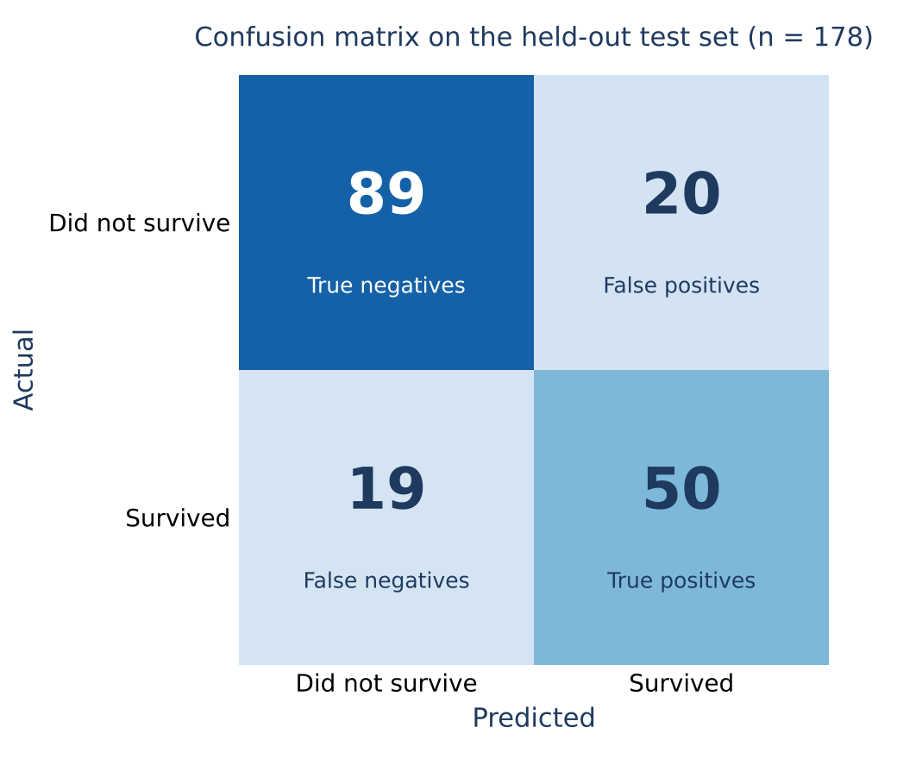
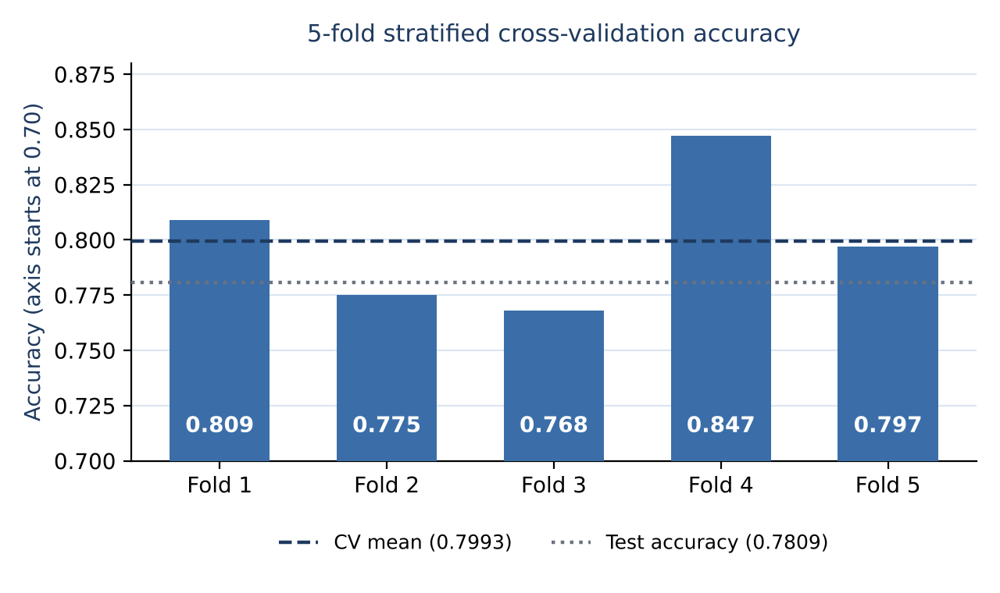

# Titanic Survival Prediction


A supervised binary classification project that predicts whether a Titanic passenger survived, built as a reproducible scikit-learn pipeline (imputation, scaling and encoding feed a logistic regression model).

**Course:** ECE 3100, Introduction to Data Science, University of Michigan
**Author:** Malik Mustafa Nasir
**Report:** [`Titanic_Survival_Prediction_Report.pdf`](Titanic_Survival_Prediction_Report.pdf)

## Results at a glance

| Metric | Value |
|---|---|
| 5-fold stratified cross-validation accuracy | **79.93%** |
| Held-out test accuracy (178 passengers) | **78.09%** |
| Passengers analysed | 887 |

<p align="center">
  
  
</p>

| Class | Precision | Recall | F1 | Support |
|---|---:|---:|---:|---:|
| Did not survive (0) | 0.82 | 0.82 | 0.82 | 109 |
| Survived (1) | 0.71 | 0.72 | 0.72 | 69 |

The model identifies non-survivors somewhat better than survivors, and its false positives (20) and false negatives (19) are nearly balanced.

## Approach

1. **Data:** the Stanford CS109 Titanic passenger list (887 passengers), loaded directly from its public URL.
2. **Features:** `Pclass`, `Age`, `Fare`, `Sex` (encoded 0/1) and an engineered `AgeGroup` (Child, Teenager, Young Adult, Adult, Senior).
3. **Preprocessing**, inside a `ColumnTransformer`:
   - Numeric: median imputation, then standard scaling
   - Categorical (`AgeGroup`): most-frequent imputation, then one-hot encoding
4. **Model:** `LogisticRegression(max_iter=1000)` with default regularisation, chained to the preprocessor in a single `Pipeline` so every step is fit on training data only.
5. **Evaluation:** stratified 80/20 train/test split (`random_state=42`) and 5-fold stratified cross-validation (shuffled, `random_state=42`), plus a confusion matrix and classification report.

### Why this design

- **Pipeline + ColumnTransformer** keeps preprocessing and modeling together, so nothing is learned from validation or test data.
- **Stratified splits** keep the survival rate consistent across folds and between the training and test sets.
- **Logistic regression** fits a binary outcome, outputs a survival probability and has interpretable coefficients.

## Limitations

- The test set is small (178 passengers), so test accuracy carries a margin of error of roughly 6 percentage points.
- Hyperparameters were left at defaults, and the original project did not compare other algorithms.
- `Age` and `AgeGroup` are both inputs, so they overlap.
- The headline cross-validation score is computed over the full dataset, which includes the test rows. The notebook also reports a stricter training-set-only cross-validation score.
- Accuracy is the headline metric, and the classes are mildly imbalanced (about 61% did not survive).

## Extension: baseline and model comparison

Added after the original submission and kept separate from the results above. Each model is scored with the same 5-fold stratified cross-validation on the full dataset (mean accuracy, with the standard deviation across folds).

| Model | CV accuracy | Std |
|---|---:|---:|
| Majority-class baseline | 0.6144 | 0.0017 |
| **Logistic regression (original model)** | **0.7993** | 0.0281 |
| Logistic regression without `AgeGroup` | 0.7892 | 0.0357 |
| Random forest (300 trees, untuned) | 0.8219 | 0.0181 |

- Always predicting "did not survive" scores 61.4%, so the logistic regression's 79.9% is a gain of about 18 points over a trivial baseline.
- Dropping `AgeGroup` lowers accuracy by about 1 point, which is within fold-to-fold variation, so there is no clear evidence the engineered feature helps.
- The random forest scores about 2 points higher, roughly one fold standard deviation. With untuned settings and 887 passengers, that is suggestive rather than conclusive. The project's model remains logistic regression, which is simpler and easier to interpret.

## Run it yourself

```bash
git clone https://github.com/mustafa-nasirr/titanic-survival-prediction.git
cd titanic-survival-prediction
python -m venv .venv
source .venv/bin/activate      # Windows: .venv\Scripts\activate
pip install -r requirements.txt
jupyter notebook titanic_survival_prediction.ipynb
```

The notebook needs an internet connection to download the dataset.

## Repository contents

| Path | Description |
|---|---|
| `titanic_survival_prediction.ipynb` | Full analysis, model and evaluation |
| `Titanic_Survival_Prediction_Report.pdf` | Four-page written report with figures |
| `confusion_matrix.png`, `cv_scores.png`, `class_metrics.png` | Figures used in this README and the report |
| `requirements.txt` | Python dependencies |
